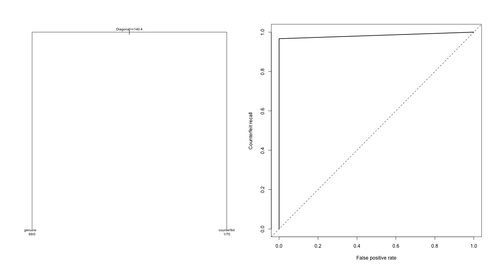

# Banknote Authenticity Tree

Held-out decision-tree evaluation with an explicitly defined counterfeit class.

**Author and maintainer:** Abhinav Tanwar.

## Run

Requires R 4.4+; install `jsonlite`, `rpart`, `mclust`, `randomForest`, and `glmnet` as applicable.

```sh
Rscript scripts/run.R
Rscript tests/checks.R
```

## Methods and limitations

Loads the original mclust banknote dataset through the R package. The positive class is explicitly counterfeit rather than relying on factor order. A stratified 70/30 split is used; tree pruning uses only training cross-validation. ROC points are ordered by increasing false-positive rate before trapezoidal integration. Rank-based and manual AUC must agree. This fixes the potential negative AUC caused by curve orientation in the source.

## Measured results

- **metrics:** roc auc = 0.9833; recall = 0.9667; precision = 1; accuracy = 0.9833.

[Full calculated metrics](results/metrics.json) · [Input provenance](data/README.md) · [Method changes](docs/methodology.md). Open `report.html` for the visual summary.


